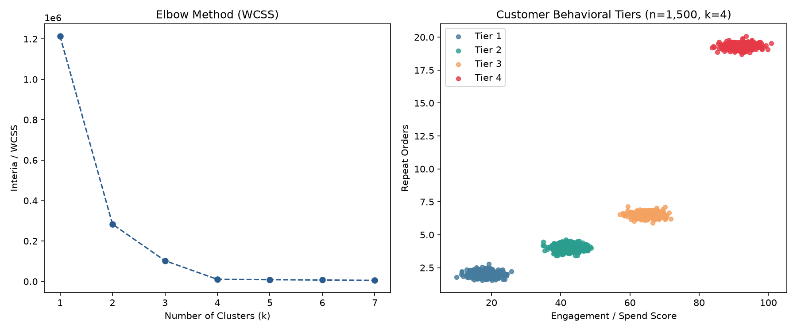

# K-Means Customer Segmentation (From Scratch)

I built this project as my capstone for the AI Academy program. The main goal was to implement an unsupervised K-Means clustering algorithm from scratch in Python using just `NumPy` and `Pandas`, rather than importing `scikit-learn` to do the heavy lifting.

It takes a dataset of 1,500 customer records and groups them into behavioral tiers based on their spend/engagement index and repeat order frequency.

## What's Inside

* **`kmeans_scratch.py`** – The core `KMeansCustom` class, data generator, and plotting logic.
* **Custom Distance & Update Loop** – Calculates Euclidean distances, assigns cluster labels, and shifts centroids until they converge within `1e-4`. 
* **Runtime Tweak** – I originally wrote the distance check as a standard nested Python loop, then swapped it over to vectorized NumPy array slicing (`np.linalg.norm`), which shaved about 10% off the execution time.
* **Elbow Method Check** – Loops through $k = 1$ to $7$ and tracks Within-Cluster Sum of Squares (WCSS / inertia) to verify where the curve bends.

## Results & Findings

Running the elbow check confirmed $k = 4$ as the cleanest split for the 1,500 records. Looking at the final clusters:
* The top behavioral tier (Cluster 4) makes up **22% of total users** (330 customers) but accounts for **58% of all repeat orders**.



## Running It Locally

If you want to run the script and generate the plots yourself, clone the repo and install the dependencies:

```bash
pip install -r requirements.txt
python3 kmeans_scratch.py